# Habla Fluido — Evidencias TDD

## Ronda 1

### Estructura
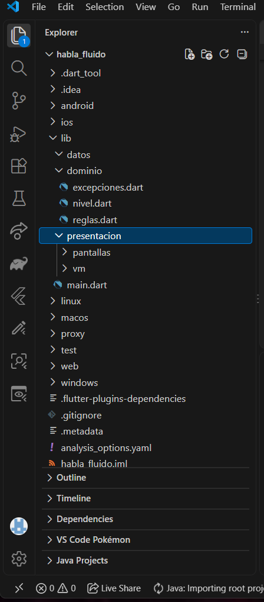

### Verde

## Ronda 2

### Rojo
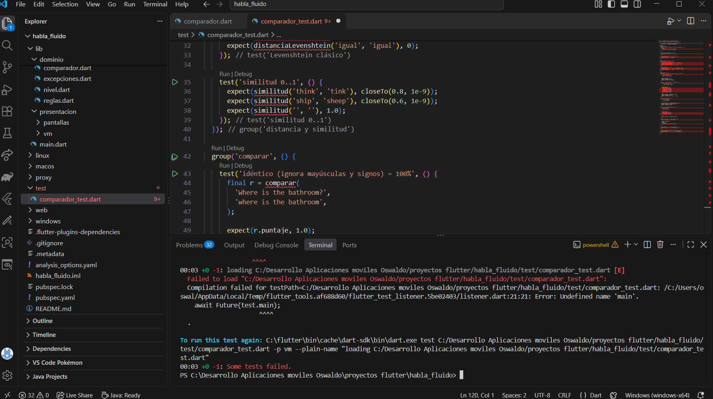

### Verde
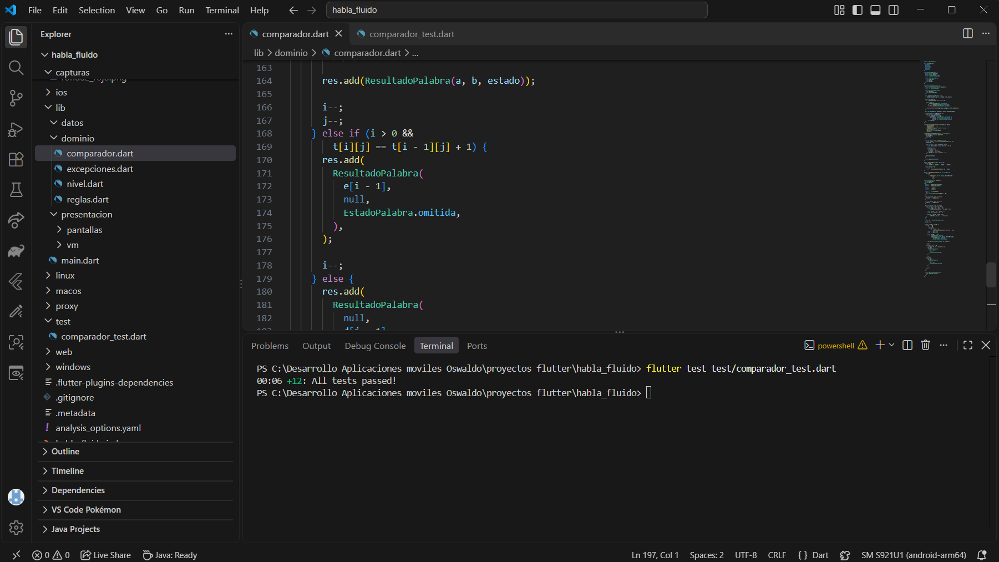

## Ronda 3

### Rojo
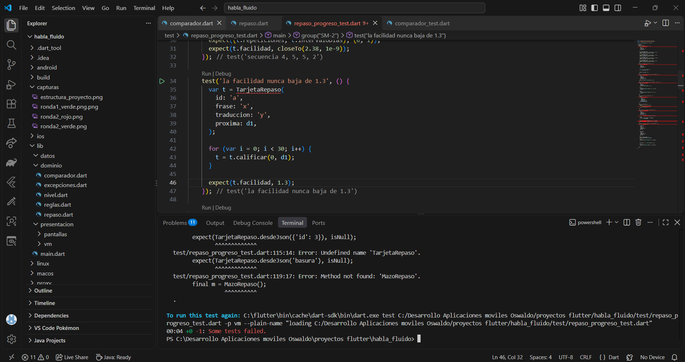

### Verde
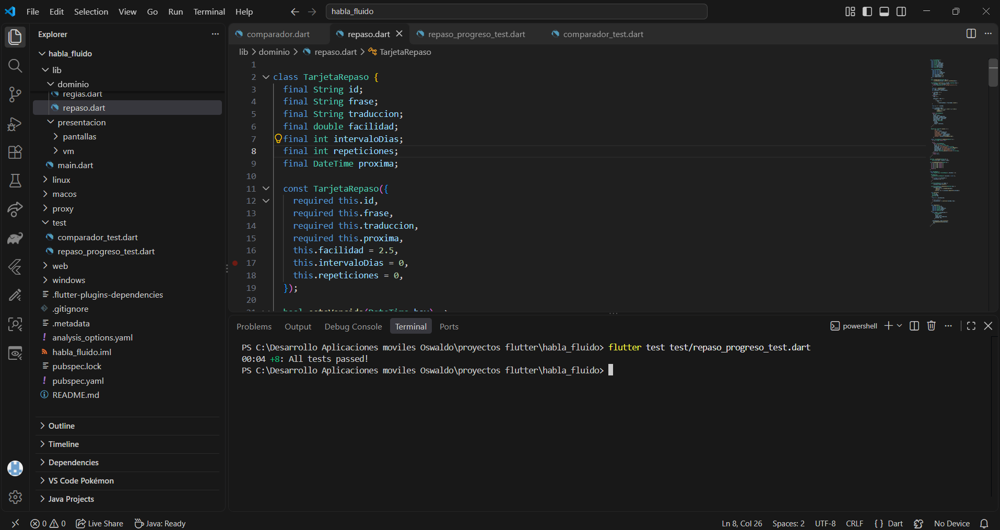

## Ronda 4

### Rojo
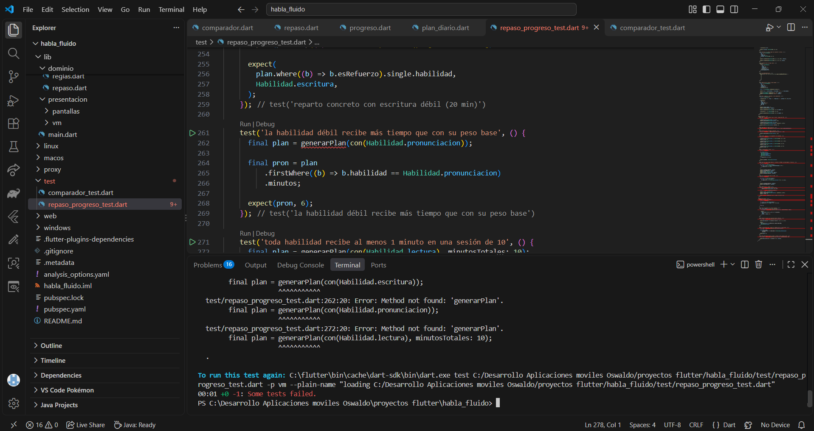

### Verde
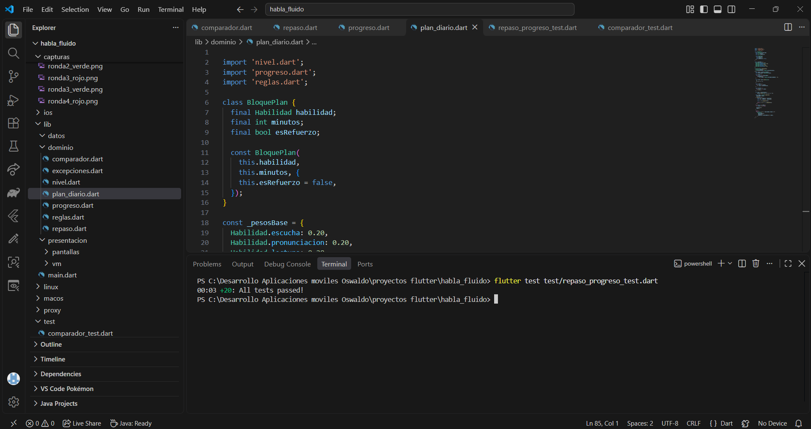

## Ronda 5

### Estructura
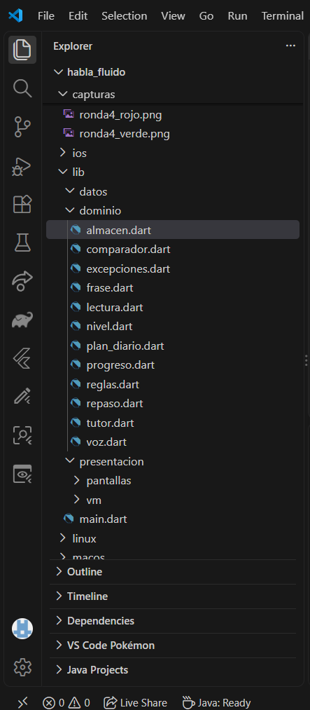

### Verde
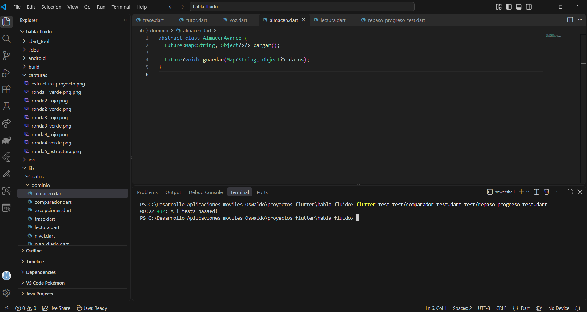

## Ronda 6

### Rojo
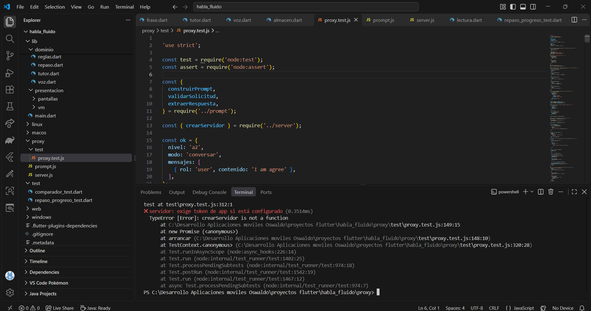

### Verde
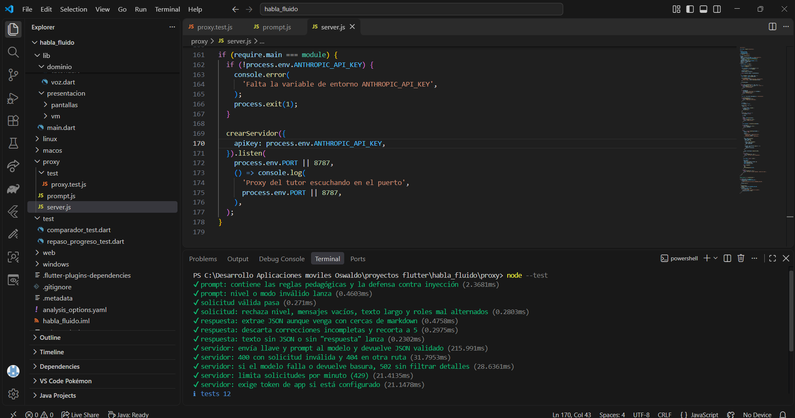

## Ronda 7

### Rojo
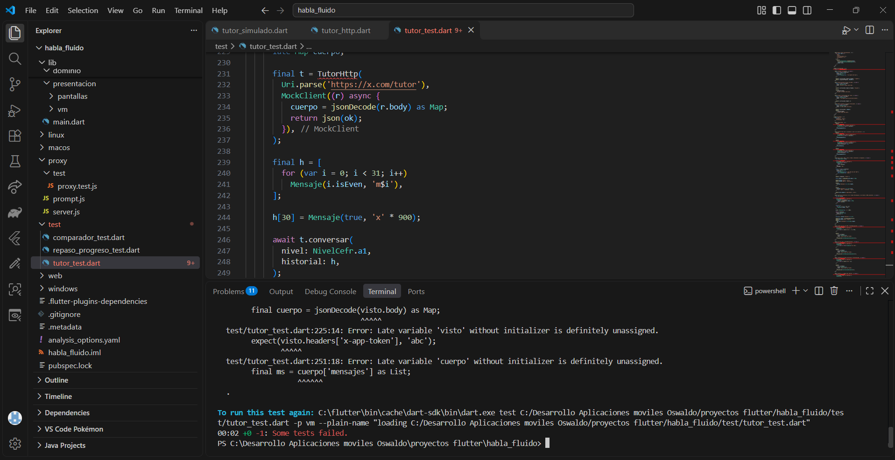

### Verde
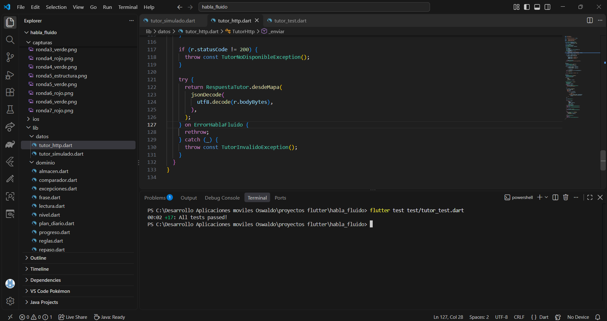

## Ronda 8

### Estructura
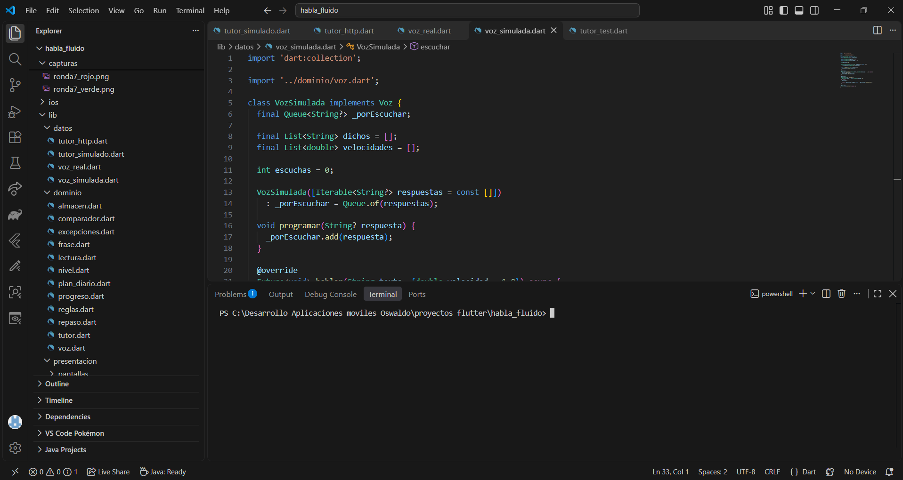

### Verde
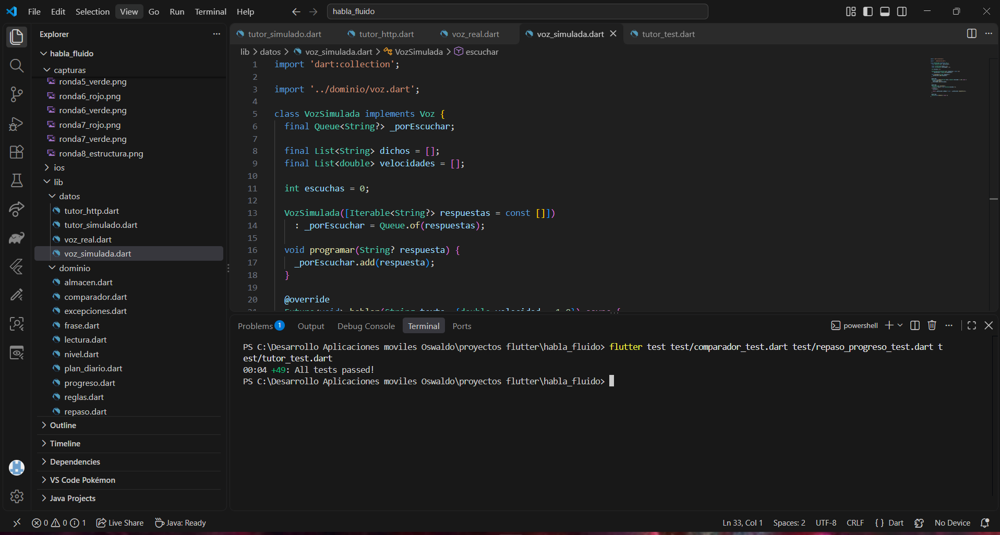

## Ronda 9

### Rojo
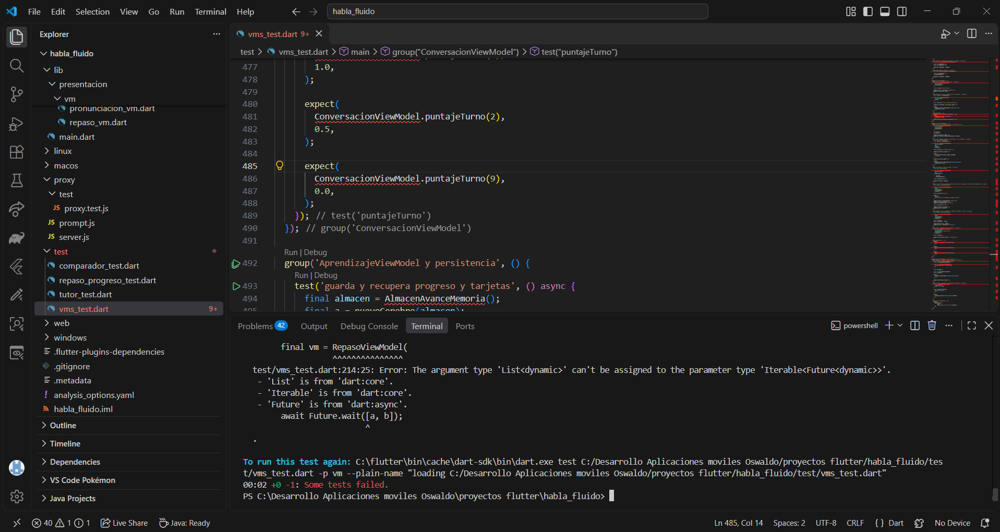

### Verde
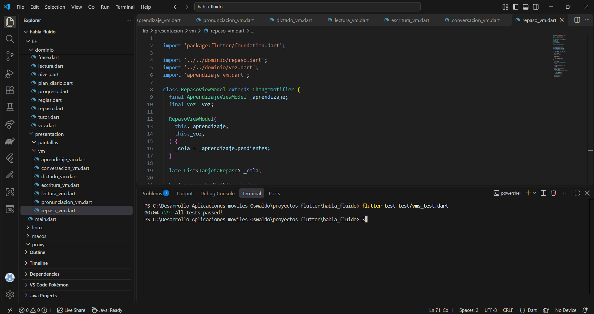
